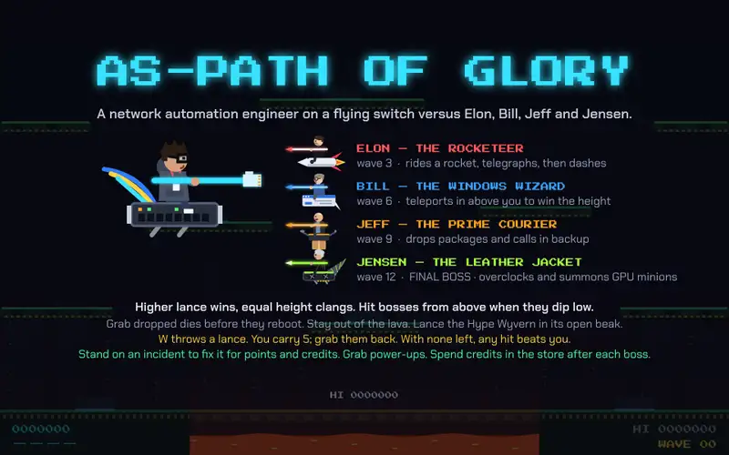

# AS-PATH OF GLORY

A momentum-based jousting arcade game in a single HTML file. You play a nerdy
network automation engineer riding a flying 1U switch, armed with a glowing
patch-cable lance, battling tech billionaires above a pit of lava.

**Play:** open `index.html` in any browser, or enable GitHub Pages for this repo.



*A 45-second highlights reel, silent. It was recorded from the real game with a script playing; the scenes are staged and cut together, so it shows the features, not one continuous run.*

## Getting started

### 1. Get the game

```sh
git clone https://github.com/lilgreml1n/AS-PATH-Of-Glory.git
cd AS-PATH-Of-Glory
```

No Git? On the GitHub page, click **Code → Download ZIP** and unzip it.

### 2. Play it

Double-click `index.html`, or drag it into a browser window. The whole game is in that one file. It needs no install, server or account. It loads its retro fonts from Google Fonts. Offline, it still plays but falls back to plain fonts.

Press any key, click or tap once to start the sound. The game shows controls on screen, and the full list is in [How to play](#how-to-play) below.

### 3. Change it (optional)

1. Edit `src/game.html`. That's the source. Don't edit `index.html` directly, because the build overwrites it.
2. Rebuild the playable file:
   ```sh
   ./build.sh
   ```
   The build needs `bash` and `sed`. On Windows, use Git Bash or WSL.
3. Reload `index.html` in the browser to try your change.
4. Commit both files so the online version updates:
   ```sh
   git add src/game.html index.html
   git commit -m "Describe your change"
   git push
   ```

Before changing gameplay, read [CONSTITUTION.md](CONSTITUTION.md). It lists the rules the game must keep, such as the higher lance winning. If you change a rule, update the README to match.

### 4. Put it online (optional)

Follow [Deploy to GitHub Pages](#deploy-to-github-pages) below. After a minute or two the game is live at **https://lilgreml1n.github.io/AS-PATH-Of-Glory/**. Share that link so people can play in their browser.

## How to play

| Action | Keyboard | Mouse | Touch |
|---|---|---|---|
| Steer | `←` `→` or `A` `D` | move the pointer; you fly toward it | ◀ ▶ buttons |
| Flap | `Space` or `↑` (tap it, don't hold) | left click | FLAP button |
| Throw lance | `W` (also `X` or `Shift`) | right click | THROW button |
| Fire a bomb (when you hold one) | `S` or `↓` | middle click, or click the `BOMB` counter | BOMB button |
| Start / play again | `Enter` or `Space` | click | tap the screen |
| Store | `←` `→`, `Space`, `P` | click an item twice | tap an item twice |
| Pause | `P` / `Esc` | click to resume | tap to resume |
| Mute | `M` | — | — |

Mouse steering works while the pointer is over the game screen. You fly toward the pointer and stop when it is within 14 px of you, left or right. Pressing a steer key hands steering back to the keyboard until you move the mouse again. After a respawn, a mouse that hasn't moved doesn't steer, so respawn protection isn't used up by a resting pointer. Pausing and muting still need the keyboard.

## Rules

- **Higher lance wins.** When two riders collide, the one whose lance is higher wins. Equal height means both bounce off with a clang.
- **Inertia.** Steering accelerates you; reversing takes effort and you skid on the ground. Flying off one side wraps you to the other.
- **Dropped dies.** Defeated enemies drop a silicon die. Grab it (250 → 500 → 750 → 1000, +500 for a mid-air catch) before it reboots into a tougher enemy.
- **Lava.** From wave 4 the bridge melts. Fly too low and a molten hand grabs you; tap flap 7 times to break free.
- **Hype Wyvern.** Linger too long and it shows up. Only a lance in its open beak kills it.
- **Wave types.** Egg waves every 5th wave; survival waves (no deaths = 3000 bonus); an extra life every 20,000 points.

### Throwing your lance

You carry **5 patch-cable lances** per life, shown as glowing plugs next to your score. Every throw uses one, so ammo is the gamble.

1. **Let it fly.** `W` hurls a lance straight ahead at lance height. It flies for about ¾ of a second, roughly half the screen, then drops. If it hits a platform, it thunks off and falls.
2. **Still holding one? Still jousting.** While you have at least one lance, the higher-lance rule works as normal.
3. **Empty = UNPLUGGED.** Throw all 5 and you have no lance. Touching any enemy or boss then costs you a life, even if you're higher. Your name tag turns red and the meter flashes `UNPLUGGED`. You can still stomp rebooting dies and collect dies.
4. **Go get them.** Lances on the ground show a bobbing `GRAB ME` tag. Touch one to collect it (up to 5).
5. **Daisy chain.** One throw goes through every minion in its path. The 1st scores normally, the 2nd double, the 3rd triple, and so on.
6. **Bullseye.** A thrown lance that hits a boss takes off one health bar (+500), same as a joust, then falls.
7. **Around the world.** If the lance flies off one edge and wraps around, every kill it makes after that adds +1000.
8. **Hot swap.** Catch one of your lances before it lands for +250.
9. **Nothing but beak.** Throw it into the Hype Wyvern's open beak (facing it) for +1500.
10. **Lava eats lances.** A lance that falls into the lava is replaced 5 seconds later ("RMA DELIVERED"). With no lances left, your tag counts down `RMA 5…4…`.

Losing a life gives you a fresh full set (5, or more if you bought spare lance slots in the store).

### Power-ups

A defeated minion drops a power-up 12% of the time, and a defeated boss always drops one. Each of the three is equally likely. The badge drifts down, settles on a platform (or hovers above open lava), and vanishes after 8 seconds. Touch it to take it.

| Power-up | What it does |
|---|---|
| **Blackhole Route** (bomb) | Stored, up to 3; a pickup when you already hold 3 pays 500 points instead. `S` fires one: every minion, rebooting die-walker and package on screen is gone, and each boss loses one health bar (+500). Minions pay their normal points (walkers 250) but drop no dies. It does not affect the Hype Wyvern or dies already on the ground. |
| **Zero-G Uplink** | Starts at once, lasts 8 seconds. Gravity on you drops to 35%, and the lava hand can't grab you. |
| **Root Access** | Starts at once, lasts 6 seconds. Any rider you touch is defeated whatever the heights, even if you're unplugged; a boss loses one health bar per touch. The Hype Wyvern passes through you harmlessly. Lava still kills. |

A ring around you, your name tag and a bar in the top-left corner show the time left. The ring blinks and a tone sounds 1.5 seconds before it runs out. Power-ups end when you lose a life; stored bombs stay.

### Incidents

Every 9 to 15 seconds a faulty rack appears on a platform with a ticket name over it. **Stand on the marked strip of platform** to fix it: the green bar fills while you stand there and drains at half speed when you step off. An incident nobody is fixing expires after 10 seconds, with no penalty. One incident is open at a time, two from wave 6.

A fix pays points, which count toward the extra life every 20,000, and **credits** to spend in the store.

| Incident | The fix | Stand for | Points | Credits |
|---|---|---|---|---|
| ARP poisoning | Dynamic ARP Inspection on | 1 s | 500 | 1 |
| Low light levels | Fiber connector cleaned | 1 s | 500 | 1 |
| Duplex mismatch | Duplex matched on both ends | 1 s | 500 | 1 |
| CRC errors | Bad optic swapped | 1 s | 500 | 1 |
| Rogue DHCP server | DHCP snooping on | 1.5 s | 750 | 2 |
| MTU mismatch | MTU matched end to end | 1.5 s | 750 | 2 |
| Broadcast storm | Storm control on | 1.5 s | 750 | 2 |
| NTP drift | Clocks resynced | 1.5 s | 750 | 2 |
| Routing loop | Redistribution filtered | 2 s | 1,000 | 3 |
| Spanning-tree loop | BPDU guard on | 2 s | 1,000 | 3 |
| BGP route leak | Prefix filter applied | 2 s | 1,000 | 3 |
| "It's DNS" | It was DNS | 2 s | 1,000 | 3 |
| BGP hijack | RPKI origin validation on | 2.5 s | 1,500 | 3 |

Defeating a boss also pays 5 credits.

### The store ("Change Window")

The store opens after every boss wave: waves 3, 6, 9 and 12, then every 4th wave in endless mode. The game is frozen while it is open. Credits last for the current run only; your count shows as `CR` at the bottom right.

| Item | Price | Effect |
|---|---|---|
| Blackhole Route | 4 | One bomb (you can hold 3). |
| Zero-G Uplink | 3 | Starts when the next wave starts. One can be queued. |
| Root Access | 5 | Starts when the next wave starts. One can be queued. |
| Spare lance slot | 6 | Carry one more lance for the rest of the run, up to 7. |
| Bridge patch | 6 | The bridge over the lava is back for the next wave only. |
| 1UP | 10 | One extra life. |

`←` `→` choose, `Space` or `Enter` buys, `P` or `Esc` starts the next wave. With a mouse or on touch, click or tap an item to select it and again to buy; the ◀ ▶ and FLAP buttons work too.

### Cheat code

Type `iamacheetah` during a wave for 5 bombs (this can take you past the usual 3). The screen then shows `CHEETAH MODE`, and that run's score no longer counts for the high score.

### Who's who

Every rider has a colored name tag under them: you, each minion type, and each boss. The bar across the bottom of the screen lists everyone currently in the arena. A boss wave opens with flashing hazard stripes, a siren, and the announcer calling the boss by name, for example "Wave 3. Warning! Elon, the rocketeer, is entering the arena!"

Details: two lances within 2.5 px count as a tie. Respawn protection lasts until you move or flap (max 4 s). Survival waves are 2, 7, 17, …; egg waves every 5th wave.

## Enemies and bosses

| Wave | Opponent | Gimmick |
|---|---|---|
| all | Scalper Bot (red) | drifts in sine waves |
| all | Crypto Miner (white) | climbs above you, then dives |
| all | Rival Silicon (blue) | fast, low, last-second lift |
| 3 | **Elon — The Rocketeer** | telegraphs, then rocket-dashes across the screen |
| 6 | **Bill — The Windows Wizard** | teleports in above you |
| 9 | **Jeff — The Prime Courier** | drops packages, calls in same-day backup |
| 12 | **Jensen — The Leather Jacket** (final boss) | overclocks and summons GPU minions; when beaten he says "I'll see you back in the boardroom!" |

Bosses alternate between chasing you from above and dipping low. Hit them from above while they're low. Beat Jensen to win; then keep going in endless mode with boss rematches every 4th wave.

## Sounds

All sounds are original 8-bit tones synthesized at run time with the Web Audio API (`tone` / `sfx` in `src/game.html`), so the code itself regenerates them. Audio starts on your first key press, click or tap; `M` mutes and the setting is saved. Every sound has a matching visual cue, so the game is fully playable muted.

| Sound | When |
|---|---|
| flap | each flap |
| clang | equal-height lance tie, boss hit, Wyvern kill |
| win | enemy defeated, walker stomped |
| egg (rising arpeggio) | die collected, pitch climbs with the chain |
| die | you lose a life |
| wave fanfare | wave starts |
| hatch | die reboots, Bill teleports, boss mounts up |
| wyvern | Hype Wyvern arrives, Elon dashes, Jensen overclocks |
| grab | lava hand grabs you |
| bump | ledge bounce, package THUD |
| throw (whoosh) | you throw your lance |
| thunk | thrown lance hits a platform or a boss |
| siren | a boss wave starts |
| announcer | a boss wave starts: the boss's name and title, spoken by your browser's built-in text-to-speech voice. That's a generic system voice, not an imitation of anyone, and it's silent when muted or where the browser has no speech. |
| life jingle | extra life, boss defeated, victory, cheat code |
| power (rising three notes) | you take a power-up |
| bomb (low boom) | you fire a Blackhole Route |
| alert (two beeps) | an incident appears |
| fix (three-note chime) | you fix an incident |
| warn (three low beeps) | Zero-G Uplink or Root Access is about to run out |
| buy / deny | a store purchase goes through / is refused |

## Project layout

```
src/game.html   source (an HTML fragment, also publishable as a claude.ai Artifact)
build.sh        wraps src/game.html into a full HTML document
index.html      built, playable game (commit this so GitHub Pages can serve it)
tests/          logic.test.js (unit tests) and smoke.js (headless run of the real game script)
```

Edit `src/game.html`, then run `./build.sh` to regenerate `index.html`.

Project rules live in [CONSTITUTION.md](CONSTITUTION.md), including what has and hasn't been verified yet. ### Tests

```sh
node --test          # unit tests for the pure rules: wave schedule, power-up drops, incidents, store
node tests/smoke.js  # runs the real game script with the browser stubbed and checks the rules above
node tests/browser.js  # plays the built game in headless Firefox: real keys, real mouse, and a bot that plays a whole run (about 8 minutes; needs Firefox)
```

The first two need only Node.js 18 or later. The unit tests cover the newer rules; the older ones (height rule, wrap distance, die points, extra lives, mute) are not unit-tested yet. See the constitution's *Current status* section.

## Deploy to GitHub Pages

Repo **Settings → Pages → Build and deployment → Deploy from a branch → `main` / root**.

## Disclaimer

A non-commercial parody made for fun. The characters are caricatures of public
figures; this project is not affiliated with or endorsed by any person or company
mentioned.
